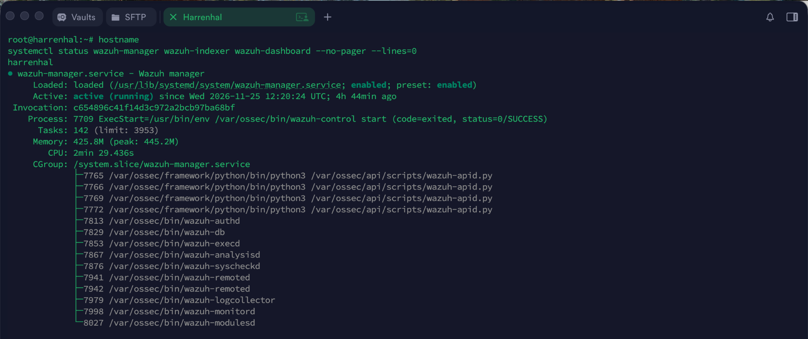
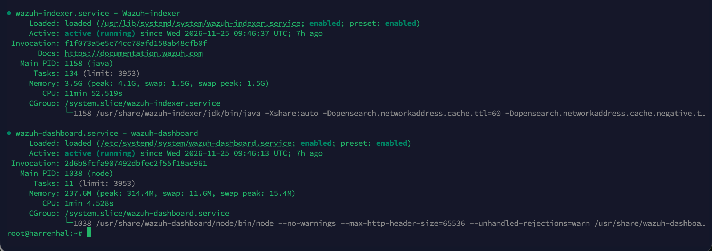
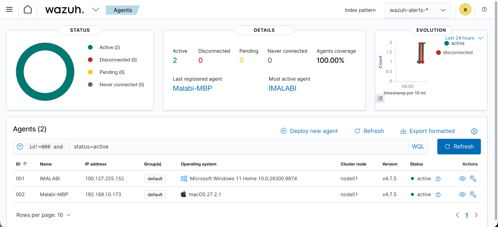
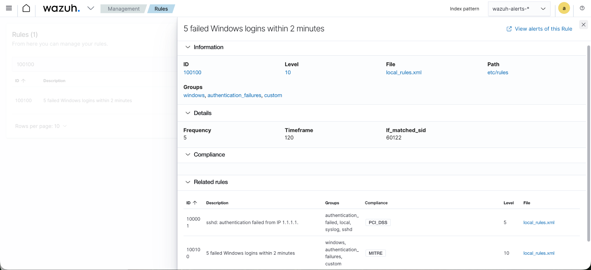
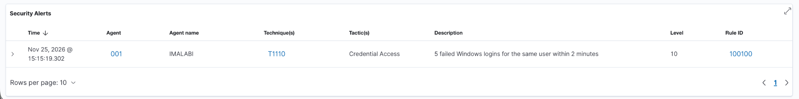

# Wazuh SIEM Home Lab

I deployed Wazuh on my Proxmox home lab, enrolled Windows and macOS endpoints, and tested a custom rule for repeated failed Windows logins.

## Deployment verification

### Wazuh services on Harrenhal

I verified that the Wazuh manager, indexer and dashboard were all running on Harrenhal.

### Endpoint monitoring

The dashboard showed both enrolled agents as active: IMALABI on Windows 11 and Malabi-MBP on macOS.

### Windows failed-login detection

I configured rule 100100 to raise a level 10 alert after five failed Windows logins within 120 seconds.

On 25 November 2026, Wazuh recorded a level 10 alert from IMALABI. The alert shows the rule description used at the time of the test. I later updated the wording to “5 failed Windows logins within 2 minutes.”

